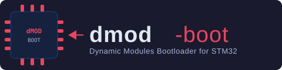

# dmod-boot

[](https://github.com/choco-technologies/dmod-boot/actions/workflows/build.yml)
[](LICENSE)

<p align="center">
  
</p>

Dynamic Modules (dMOD) bootloader - A minimalistic embedded project for STM32 microcontrollers.

## Setting Up Your Environment

### Option 1: Docker (Recommended for Easy Setup)

The easiest way to get started is to use the pre-configured Docker image that includes all necessary tools:

```bash
docker run -it --rm \
    -v $(pwd):/workspace \
    -w /workspace \
    chocotechnologies/dmboot:1.0.0 \
    bash
```

This Docker image includes:
- ARM GNU toolchain (arm-none-eabi-gcc)
- CMake
- Renode emulator
- All dMOD tools and libraries
- Python development environment

Once inside the container, you can proceed directly to [Building](#building).

### Option 2: Native Linux Setup

If you prefer to set up your Linux environment natively, we provide an automated setup script that installs all necessary tools and dependencies:

```bash
./scripts/setup-linux-env.sh
```

**What this script does:**
1. Calls the DMOD base environment setup (installs ARM toolchain, CMake, and other core tools)
2. Installs additional dMOD Boot specific packages:
   - Renode emulator
   - ncurses libraries (with automatic fallback for modern systems)
   - GTK libraries (with T64 ABI support)
   - Python 3 and pip
   - Other development utilities
3. Sets up the environment variables and bash aliases

**Advanced options:**

```bash
# Skip DMOD base setup if you've already set it up separately
./scripts/setup-linux-env.sh --skip-dmod-setup

# Specify custom tool directory
./scripts/setup-linux-env.sh --tools-dir /opt/tools

# Specify custom Renode version
./scripts/setup-linux-env.sh --renode-version 1.14.0

# View all available options
./scripts/setup-linux-env.sh --help
```

After running the script, restart your terminal or run:
```bash
source ~/.bashrc
```

## Building

### Building for Hardware

```bash
mkdir build
cd build
cmake ..
cmake --build .
```

### Selecting a Target or Board

By default, the build targets the `STM32F746xG` microcontroller. You can select a different target or use a predefined board configuration:

**Using the `TARGET` parameter** – specify a microcontroller directly:

```bash
cmake -DTARGET=STM32F407G -S . -B build
cmake --build build
```

Supported values: `STM32F746xG`, `STM32F407G`, `STM32F746ZG`, `ESP32S3`.

**Using the `BOARD` parameter** – select a ready-made board configuration that automatically sets `TARGET` and other board-specific settings:

```bash
cmake -DBOARD=stm32f746g-disco -S . -B build
cmake --build build
```

Board configuration files are located in `configs/board/<BOARD>/board.cmake`. When `BOARD` is set, the `TARGET` parameter is ignored.

### STM32F746G-DISCO: the Car HMI Demo

The `stm32f746g-disco` board runs the [car HMI demo](https://github.com/choco-technologies/carhmi-demo)
out of the box: its `flash.dmd` starts the display (`dmview`), audio
(`dmaudio`, on the WM8994 codec) and the `carhmi` service, and its
`sdcard.dmd` downloads the view, which is too big for the flash, to
`build/sdcard`. Flash the firmware, then send the view to the card in the slot
(FAT, first partition):

```bash
cmake -DBOARD=stm32f746g-disco -S . -B build
cmake --build build
cmake --build build --target install-all     # the firmware, then build/sdcard and build/ext over the console
```

The player plays the MP3 files of `music/` on the card. Copy them there on a
PC, or send them over the console:

```bash
scripts/ymodem_send.py --dest music *.mp3
```

carhmi reads the directory when it starts: restart it (`service restart carhmi`)
or the board after adding files - a few seconds after the transfer, so FAT has
written them to the card.

### Building for LILYGO T-Deck Pro

The T-Deck Pro is based on the **ESP32-S3FN16R8** (Xtensa LX7 dual-core, 240 MHz, 16 MB flash, 8 MB PSRAM).

**Prerequisites:**

- [Espressif ESP32-S3 toolchain](https://docs.espressif.com/projects/esp-idf/en/latest/esp32s3/get-started/linux-macos-setup.html) (`xtensa-esp32s3-elf-gcc`)
- [Espressif OpenOCD fork](https://github.com/espressif/openocd-esp32) (supports the built-in USB JTAG of the ESP32-S3)

**Build using the board preset:**

```bash
cmake -DBOARD=t-deck-pro -S . -B build
cmake --build build
```

**Or specify the target directly:**

```bash
cmake -DTARGET=ESP32S3 -S . -B build
cmake --build build
```

**Flash via OpenOCD** (T-Deck Pro has a built-in USB JTAG, no external probe needed):

```bash
cmake --build build --target install-firmware
```

This runs:
```
openocd -f interface/esp_usb_jtag.cfg -f target/esp32s3.cfg \
        -c "program dmboot.elf verify reset exit"
```

> **Note:** The firmware is loaded directly into IRAM/DRAM, bypassing the ROM bootloader's cache setup. This makes the development cycle fast and requires no partition table or bootloader binary.

### Building for Renode Simulation

To build for Renode simulation (useful for automated testing without hardware):

```bash
mkdir build
cd build
cmake -DDMBOOT_EMULATION=ON ..
cmake --build .
```

With emulation mode enabled, the workflow targets (`install-firmware`, `connect`, `monitor-gdb`) work similarly to hardware mode but use Renode instead of OpenOCD.

**Why Renode?** Renode provides excellent STM32F7 Discovery board emulation with complete peripheral support, accurate memory mapping, and full interrupt controller implementation. This enables proper firmware execution and log capture via monitor-gdb, making it ideal for CI testing and verification.

### Building with Embedded Files

You can optionally embed binary files in ROM during the build:

```bash
cmake -DCMAKE_BUILD_TYPE=Debug \
      -DTARGET=STM32F746xG \
      -DSTARTUP_DMP_FILE=path/to/startup.dmp \
      -DUSER_DATA_FILE=path/to/user_data.dat \
      -DDMBOOT_CONFIG_DIR=path/to/config_directory \
      -S . -B build
cmake --build build
```

**Build Parameters:**
- `TARGET` (optional, defaults to `STM32F746xG`) - Target microcontroller. Supported values: `STM32F746xG`, `STM32F407G`, `STM32F746ZG`, `ESP32S3`. Ignored when `BOARD` is set.
- `BOARD` (optional) - Board name. When set, `TARGET` and other board-specific settings are automatically derived from `configs/board/<BOARD>/board.cmake`, so you don't need to set `TARGET` manually. Examples: `-DBOARD=stm32f746g-disco`, `-DBOARD=t-deck-pro`.
- `STARTUP_DMP_FILE` (optional) - Path to a startup package file (`.dmp`) that will be automatically loaded using `Dmod_AddPackageBuffer` at boot
- `USER_DATA_FILE` (optional) - Path to a user data file that will be embedded in ROM, with its address and size available via environment variables `USER_DATA_ADDR` and `USER_DATA_SIZE`
- `DMBOOT_CONFIG_DIR` (optional, defaults to `build/cfg`) - Path to a directory that will be converted to a dmffs filesystem image and mounted at `/cfg/` at boot time. Configuration entries in the flash `*.dmd` files are routed via `dmf-get --config-map` based on their tag (`driver=`, `rule=`, `service=`) into `drivers/`, `rules/` and `services/` subdirectories under this path; untagged entries fall back to the directory root. The sdcard and ext modules bring their configuration with them, in the same layout: `build/sdcard/cfg/` and `build/ext/cfg/` go to `<card>/cfg/` and `/ext/cfg/`, where libsystemd and dmdevfs load it once the file system is mounted (see [Configuration of a mount point](#configuration-of-a-mount-point)). A build directory configured before `/configs` became `/cfg` is switched over automatically when it still has the old defaults.
- `DMBOOT_MAIN_MODULE` (optional, defaults to `dmell`) - Name of the main module to start after boot. Set to empty string to disable.
- `DMBOOT_LICENSE_DIR` (defaults to `build/lic`) - Flash module licenses collected on the host in `<dir>/<module>/`. SD card module licenses are installed separately to `build/sdcard/lic/<module>/`.
- `DMBOOT_EMBED_LICENSES` (defaults to `OFF`) - Embed flash module licenses as `license_fs.dmffs` and mount them at `/lic/<module>/`. Enable only when there is enough flash space; this option does not affect licenses on the SD card.
- `DMBOOT_EVIEWS_DIR` (optional, defaults to `build/eviews`) - Directory where `dmf-get` installs the views (`.dmv`) of the flash modules, each module in its own subdirectory (`<dir>/<module>`). It is converted to a dmffs filesystem image, embedded like the config filesystem and mounted at `/eviews/` at boot time, so the views of module `X` are in `/eviews/X/`. Views of the sdcard modules stay on the sdcard, in `build/sdcard/views/<module>/`. Selecting an application with views in a `*.dmd` file is enough to get its views installed.
- `DMBOOT_SPLASH_LOGO` (optional, set by the board configuration - `dmodos_logo_128` for `stm32f746g-disco`) - Splash logo the display driver shows as soon as the display is up: the name of an asset in [`assets/splash/`](assets/splash/README.md) or a path to a `.dmvi` file. The build unpacks it into a `.dmvir` (raw pixels, nothing to decode) and puts it into the embedded views filesystem at `DMBOOT_SPLASH_LOGO_PATH`.
- `DMBOOT_SPLASH_LOGO_PATH` (optional, defaults to `/eviews/splash_logo.dmvir`) - Path of the splash logo on the target, set as the `SPLASH_LOGO` environment variable at boot (read by dmlcdtft).
- `DMBOOT_MAIN_MODULE_CONFIG` (optional) - Configuration file for the main module (e.g. `board/stm32f746g-disco.ini`). Only used when `DMBOOT_MAIN_MODULE` is set. When specified, this config is passed to `dmf-get` when downloading the main module.
- `DMBOOT_EXTRA_FLASH_DMD_MANIFESTS` (optional) - Semicolon-separated list of manifest paths/URLs (one per extra flash.dmd file). Use this to specify a custom manifest for each extra flash.dmd file.
- `DMBOOT_EXTRA_SDCARD_DMD_FILES` (optional) - Semicolon-separated list of additional `sdcard.dmd` files. Each file adds more sdcard modules to download at build time.
- `DMBOOT_EXTRA_SDCARD_DMD_MANIFESTS` (optional) - Semicolon-separated list of manifest paths/URLs (one per extra sdcard.dmd file). Use this to specify a custom manifest for each extra sdcard.dmd file.
- `DMBOOT_EMULATION` (optional) - Enable Renode simulation mode instead of hardware mode

**Automatic Build-Time Embedding:**
- `modules.dmp` - Automatically created and embedded during build if modules are specified in `modules/modules.dmd`. This file is loaded before `startup.dmp` at boot time. If no modules are defined, the file won't exist, which is not an error.

All parameters are optional. If not specified, the build will proceed with default settings.

For a full list of all available CMake options (including DMOD library and VFS configuration), see [docs/cmake-options.md](docs/cmake-options.md).


### Configuration of a mount point

Every module's configuration goes where the module goes. The flash modules' units, rules and driver configurations
are in the firmware (`/cfg`); an SD card or the external flash carries the configuration of its own modules in
`cfg/`, beside their `bin/`:

```
/cfg/{services,rules,drivers}/          flash modules (firmware)
/mnt/<label>/cfg/{services,rules,drivers}/   sdcard modules (build/sdcard/cfg, upload-files)
/ext/cfg/{services,rules,drivers}/      ext modules (build/ext/cfg, upload-ext)
```

libsystemd implements dmfsi's `_mount_changed` dif, which dmvfs calls after every mount and before every unmount: once a
file system is mounted it adds its `cfg/services` and `cfg/rules` to what it has loaded and starts the units; before
it is unmounted they stop and go away again (the unmount waits for it). It also reports the mount as a device of class
`mount`, and `devscan.rules` starts the one-shot `devscan` service (from dmdevfs) for it, which asks dmdevfs - an
ioctl on `/dev` - to configure its `cfg/drivers`, and to drop them before the unmount; nothing stays running. So a
service of a module on the card starts when the card is there - not at boot, before automount has mounted it - and
stops when the card goes. In such a unit `%m` is the mount point, e.g. `exec=%m/bin/app.dmfc` for the module of that very
card.

## CMake Targets

The following targets work in both hardware mode (with OpenOCD) and Renode simulation mode. The workflow is identical regardless of the mode.

### `install-firmware`
Install firmware on the target.

- **Hardware mode:** Flashes firmware to the microcontroller via OpenOCD
- **Renode mode:** Copies firmware to a known location for Renode to use

```bash
cmake --build . --target install-firmware
```

### `connect`
Connect to the target and start the debug server.

- **Hardware mode:** Starts OpenOCD server that allows debugging and monitoring
- **Renode mode:** Starts Renode with GDB server on port 3333

```bash
cmake --build . --target connect
```

Keep this running in one terminal while using other debugging/monitoring tools.

### `monitor`
Monitor logs from the firmware in real-time via OpenOCD. This target:
- Automatically builds the `dmlog_monitor` tool for the host architecture
- Extracts the ring buffer address from the firmware's map file
- Runs `dmlog_monitor` with the correct configuration

**Usage:**

In one terminal, start OpenOCD:
```bash
cmake --build . --target connect
```

In another terminal, start the monitor:
```bash
cmake --build . --target monitor
```

The monitor will display logs from the firmware in real-time. Press Ctrl+C to exit.

The log buffer is the first section of the RAM (`.logs`): on a Cortex-M7 it
is made non-cacheable with an MPU region, so the monitor reads and writes it
past the data cache.

### Caches (Cortex-M7)

The instruction and data caches are enabled before `main()` runs
(`src/arch/armv7/cortex-m7/caches.c`). External SDRAM is cached once its
driver (dmfmc) has verified it; drivers that let a DMA controller or a
peripheral see cached memory clean and invalidate it by address (dmsdio,
dmlcdtft), the `dma` heap is the DTCM, which is never cached, and the module
loader calls `Dmod_SyncCode()` once a module is in place, so its code
reaches the instruction fetch.

### Heaps and their tags

A heap's name is the list of its tags - kinds of memory (dmheap): drivers find
the DMA heap by a tag (`dmheap_get_context_by_name("dma")`), modules ask for
memory of a kind with `Dmod_MallocTagged("fast", ...)` and get the default
memory when there is none. `DMBOOT_DMA_HEAP_TAGS` and `DMBOOT_MAIN_HEAP_TAGS`
name the heaps (`dma`, `main` by default); an MCU's configuration says what its
memories are - the STM32F746's DMA heap is the DTCM, `dma,fast,dtcm`: the
fastest RAM there is, given to what is worked on all the time (dmmp3's decoder
state: 70 % of the CPU in the SDRAM, 15 % there).

### `monitor-gdb`
Monitor logs from the firmware in real-time via GDB server. This target:
- Automatically builds the `dmlog_monitor` tool for the host architecture
- Extracts the ring buffer address from the firmware's map file
- Runs `dmlog_monitor` with GDB backend configuration

This target works identically in both hardware and Renode modes, as it connects via the GDB protocol.

**Usage:**

In one terminal, start the debug server:
```bash
cmake --build . --target connect
```

In another terminal, start the monitor using GDB mode:
```bash
cmake --build . --target monitor-gdb
```

The monitor will connect to the GDB server at `localhost:3333`. Press Ctrl+C to exit.

**Note:** Both OpenOCD and Renode provide a GDB server on port 3333. The `monitor-gdb` target connects to this GDB server interface using the GDB Remote Serial Protocol, which is an alternative to using OpenOCD's telnet interface (port 4444) used by the `monitor` target. Both methods work equally well for monitoring logs.

### `debug`
Start GDB and connect to OpenOCD for debugging.

```bash
cmake --build . --target debug
```

### `upload-files` / `install-all`
Send files the firmware does not hold (views, configurations, anything for
the SD card) to the device over its UART console, with YMODEM: dmell's
`ymodem recv` command receives them, `scripts/ymodem_send.py` (Python 3,
no pyserial needed) types it and sends the files - their paths kept under
the destination directory.

The files go to the SD card: the script asks the device what is mounted in
`/mnt` - automount mounts a card at `/mnt/<label>`, or `/mnt/<node name>`
without one (`/mnt/dmsdio0_0p1`) - and sends them there when there is one
card. With several, `DMBOOT_UPLOAD_CARD` names it; an absolute
`DMBOOT_UPLOAD_DEST` is used as it is.

Flash module binaries are installed into `build/dmf/`, and modules listed in
`sdcard.dmd` into `build/sdcard/bin/`. Both directories contain only `.dmf` or
`.dmfc` files. Package resources and `.dmd`/`.dmr` metadata stay on the host in
`build/packages/flash/` and `build/packages/sdcard/`; download markers live under
`build/modules/`.

Flash module licenses are collected in `build/lic/<module>/` on the host. They
are not embedded by default. Configure `-DDMBOOT_EMBED_LICENSES=ON` to include
them in firmware and mount them at `/lic/<module>/`; this consumes flash space.
SD module licenses go to `build/sdcard/lic/<module>/`, which the default upload
copies to `/mnt/<label>/lic/<module>/`. Views remain in
`build/sdcard/views/<module>/` and arrive at `/mnt/<label>/views/<module>/`.
The binary files arrive at `/mnt/<label>/bin/`.

This requires `dmf-get` with `--package-dir` and `--license-dir` support. Build
the host tools from the pinned `lib/dmod` revision and install them, or configure
`-DDMF_GET=/absolute/path/to/dmf-get`. CMake reports an error for older tools.

When upgrading, non-binary entries previously downloaded into `build/dmf` or
`build/sdcard/bin` are preserved under the corresponding
`build/packages/<flash|sdcard>/legacy-output/` directory before downloading.
Existing backup entries are never overwritten. Files already on a physical card
are not moved or removed by a build or upload.

The default `DMOD_REPO_PATHS` includes `/mnt/*/bin` and `/ext/bin` (the external
flash of the board, see [docs/external-flash.md](docs/external-flash.md)). The loader caches the
expanded directories and automount invalidates that cache after successful
mounts and unmounts. Flash modules take precedence over card modules; cards
are searched in alphabetical path order. New files uploaded into `bin`
are visible without refreshing the cache. Existing CMake caches retain
their `DMOD_REPO_PATHS` value; update it to
`/mnt/*/bin:/flash/dmf:/flash/dmfc` to enable card lookup. This requires
the dmod cache API and the matching libautomount update.

When upgrading an existing build, remove the old downloaded files from the
root of `build/sdcard` after checking the new `bin` directory; otherwise
`upload-files` will also send those old copies. Files already on the card
are not removed by an upload.

- `upload-files` - to a device that is running
- `install-all` - `install-firmware`, then the SD card files once the device has started,
  followed by `build/ext` on boards with `DMBOOT_EXT_DEVICE`. Modules downloaded from
  `ext.dmd` go to `${DMBOOT_EXT_MOUNT}/bin` (normally `/ext/bin`), using the same YMODEM
  transfer as `upload-ext`. The transfers run sequentially, including in parallel builds.
  The external flash must already be formatted and mounted; run `format-ext` separately
  on a new chip (see [external-flash.md](docs/external-flash.md)).

```bash
cmake --build . --target upload-files
```

| Variable | Default | Description |
|----------|---------|-------------|
| `DMBOOT_UPLOAD_PORT` | `/dev/ttyACM0` | The device's console |
| `DMBOOT_UPLOAD_BAUD` | `921600` | Its baud rate |
| `DMBOOT_UPLOAD_DEST` | empty | Directory on the card (relative, empty: its root), or an absolute one |
| `DMBOOT_UPLOAD_CARD` | `auto` | The card: its name in `/mnt`, `auto` (the one there is), `none` (the shell's directory) |
| `DMBOOT_UPLOAD_SOURCES` | `build/sdcard` | Files and directories (`SRC=NAME` sends SRC as NAME) |
| `DMBOOT_UPLOAD_BLOCK` | `1024` | YMODEM block size (128 or 1024) |
| `DMBOOT_UPLOAD_WAIT` | `60` | `install-all`: seconds the device may take to start |

The script works on its own too:

```bash
scripts/ymodem_send.py --dest views view.dmv fonts/            # views/ on the card
scripts/ymodem_send.py --card bootfs --dest views view.dmv      # of the card in /mnt/bootfs
scripts/ymodem_send.py --dest /mnt/sd/views view.dmv            # an absolute directory
```

### Restarting the system

The flash module set includes dmell's `reboot` command. On ARMv7-M targets
(Cortex-M4 and Cortex-M7), it calls the `Dmod_Reboot()` SAL implementation
and requests a system reset through SCB AIRCR (`SYSRESETREQ`). The implementation
is linked as an object library so the weak SAL default cannot hide it.
Other architectures retain the default `-ENOSYS` response until they implement
this SAL operation.

`reboot` resets immediately and does not stop services or flush filesystems.
Save pending work first. `reboot --help` shows usage without resetting.
Requires a dmell release containing the `reboot` module and a DMOD revision
exporting `Dmod_Reboot()`.
